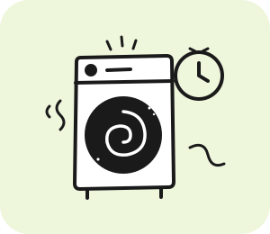

<p align="center">
  
</p>

<h1 align="center">wa:sh</h1>

<p align="center">
  <strong>Never forget your laundry in the basement again.</strong><br>
  A small laundry timer for washer and dryer – for Android, iOS and Home Assistant.
</p>

<p align="center">
  <a href="https://github.com/K0RBI02/wa-sh/actions/workflows/ci.yml"></a>
  <a href="https://github.com/K0RBI02/wa-sh/actions/workflows/integration.yml"></a>
  <a href="LICENSE"></a>
</p>

---

In apartment buildings the washer and dryer usually live in the basement. You
start a load, head back upstairs – and only remember it hours later. By then the
machine is blocked, the laundry smells musty, and the neighbours are giving you
looks.

**wa:sh** is the alarm clock for that: pick the machine, tap a program, done. The
app lets you know before your laundry is done, when it's done – and nudges you
again if it's still sitting down there.

## How it works

<table>
  <tr>
    <td align="center" width="33%"></td>
    <td align="center" width="33%"></td>
    <td align="center" width="33%"></td>
  </tr>
  <tr>
    <td valign="top"><strong>1 · Start</strong><br>Pick washer or dryer, tap one of your two favourite programs – or set a custom time.</td>
    <td valign="top"><strong>2 · Relax</strong><br>Countdown and progress bar keep running, on the lock screen too. The first reminder arrives 10 minutes before the end.</td>
    <td valign="top"><strong>3 · Down to the basement</strong><br>Done! Mark it collected, “remind me in 5 minutes” – or move straight on to the dryer.</td>
  </tr>
</table>

## What wa:sh does

- **Washer and dryer at the same time** – both run independently, each with its own timer.
- **Always in view** – on Android a persistent notification with the time left (a Live Update in the status bar from Android 16), on iPhone a Live Activity on the lock screen and in the Dynamic Island.
- **Reminds without nagging** – “almost done”, “done” and, if needed, a “not collected yet?” with rotating one-liners. Every kind can be tuned per machine.
- **Quick start** – long-press the app icon, tap a program, the timer is running.
- **Your own programs** – two favourites per machine, name and duration up to you.
- **Home Assistant** – optional: washer and dryer show up as devices in your smart home, with status, time left and events for your own automations.
- **Calm by design** – hand-drawn doodles, subtle animations, large type. “Reduce motion” and large system fonts are respected.
- **Private** – no account, no ads, no trackers. Everything stays on your phone (and, if you like, on your own Home Assistant). → [Privacy](PRIVACY.md)

> The app itself currently speaks German.

## Home Assistant

The integration ships right along. Once paired, **Washer** and **Dryer** appear
as devices in Home Assistant – with status, “finishes at”, time left, progress
and program. Home Assistant knows on its own when the laundry is done, even if
the phone is switched off.

1. **Install:** HACS → ⋮ → *Custom repositories* → `https://github.com/K0RBI02/wa-sh` (type *Integration*) → download **wa:sh** → restart Home Assistant.
2. **Pair:** *Settings → Devices & services → Add integration → wa:sh*. Home Assistant shows a code – enter it in the app under *Meine Programme → Home Assistant*. Done.

No token, no relay server. Example automations and all details:
[docs/HOME-ASSISTANT.md](docs/HOME-ASSISTANT.md)

## Install

wa:sh is a native Flutter app for **Android** and **iOS**. Ready-made APKs will
appear under [Releases](https://github.com/K0RBI02/wa-sh/releases); until then
you can build it yourself:

```bash
git clone https://github.com/K0RBI02/wa-sh.git && cd wa-sh
python3 tool/setup.py
flutter run
```

Everything else – iOS setup, tests, releases, code layout – is in
[docs/DEVELOPMENT.md](docs/DEVELOPMENT.md).

## Contributing

Ideas, bugs, wishes: please open an [issue](https://github.com/K0RBI02/wa-sh/issues).
What changed is in the [changelog](CHANGELOG.md).

## License

[MIT](LICENSE) · Font: [Instrument Sans](assets/fonts/OFL.txt) (SIL Open Font License)
