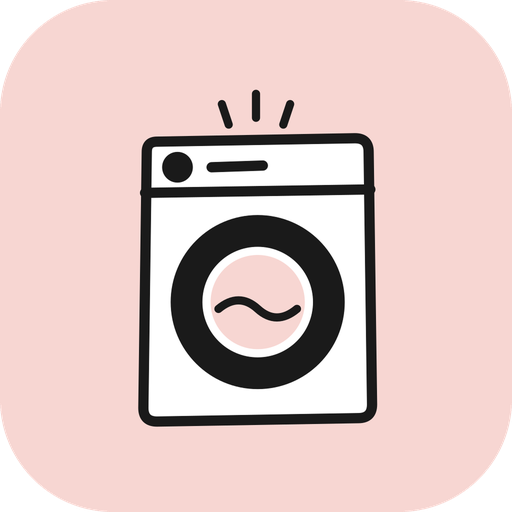
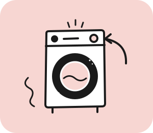

<p align="center">
  
</p>

<h1 align="center">wa:sh</h1>

<p align="center">
  <strong>Nie wieder Wäsche im Keller vergessen.</strong><br>
  Ein kleiner Wäsche-Timer für Waschmaschine und Trockner – für Android, iOS und Home Assistant.
</p>

<p align="center">
  <a href="https://github.com/K0RBI02/wa-sh/actions/workflows/ci.yml"></a>
  <a href="https://github.com/K0RBI02/wa-sh/actions/workflows/integration.yml"></a>
  <a href="LICENSE"></a>
</p>

---

In Wohnanlagen stehen Waschmaschine und Trockner meistens im Keller. Man startet
die Wäsche, geht wieder hoch – und denkt erst Stunden später daran. Bis dahin ist
die Maschine blockiert, die Wäsche müffelt, und die Nachbarn schauen schon komisch.

**wa:sh** ist der Wecker dafür: Maschine wählen, Programm tippen, fertig. Die App
sagt Bescheid, bevor die Wäsche fertig ist, wenn sie fertig ist – und hakt nach,
wenn sie dann immer noch unten liegt.

## So geht’s

<table>
  <tr>
    <td align="center" width="33%"></td>
    <td align="center" width="33%"></td>
    <td align="center" width="33%"></td>
  </tr>
  <tr>
    <td valign="top"><strong>1 · Starten</strong><br>Waschmaschine oder Trockner wählen, eins deiner zwei Lieblingsprogramme antippen – oder eine eigene Zeit einstellen.</td>
    <td valign="top"><strong>2 · Ruhig bleiben</strong><br>Countdown und Fortschrittsbalken laufen mit, auch auf dem Sperrbildschirm. 10 Minuten vor Ende kommt die erste Erinnerung.</td>
    <td valign="top"><strong>3 · Ab in den Keller</strong><br>Fertig! Abholen, „in 5 Minuten nochmal erinnern“ – oder direkt weiter in den Trockner.</td>
  </tr>
</table>

## Was wa:sh kann

- **Waschmaschine und Trockner gleichzeitig** – beide laufen unabhängig, jede mit eigenem Timer.
- **Immer im Blick** – auf Android eine dauerhafte Anzeige mit Restzeit (ab Android 16 als Live Update in der Statusleiste), auf dem iPhone eine Live Activity auf dem Sperrbildschirm und in der Dynamic Island.
- **Erinnert, ohne zu nerven** – „gleich fertig“, „fertig“ und, falls nötig, ein „noch nicht abgeholt?“ mit wechselnden Sprüchen. Jede Art lässt sich pro Maschine einzeln einstellen.
- **Schnellstart** – App-Icon lange drücken, „Bunt 40° waschen“ tippen, der Timer läuft.
- **Eigene Programme** – zwei Favoriten pro Maschine, Name und Dauer frei wählbar.
- **Home Assistant** – optional: Waschmaschine und Trockner erscheinen als Geräte in deinem Smart Home, mit Status, Restzeit und Ereignissen für eigene Automationen.
- **Ruhig gestaltet** – handgezeichnete Doodles, dezente Animationen, große Schrift. „Bewegung reduzieren“ und große Systemschrift werden respektiert.
- **Privat** – kein Konto, keine Werbung, keine Tracker. Alles bleibt auf deinem Handy (und, wenn du willst, bei deinem eigenen Home Assistant). → [Datenschutz](PRIVACY.md)

## Home Assistant

Die Integration kommt gleich mit. Nach dem Koppeln stehen **Waschmaschine** und
**Trockner** als eigene Geräte in Home Assistant – mit Status, „Fertig um“,
Restzeit, Fortschritt und Programm. Home Assistant weiß selbst, wann die Wäsche
fertig ist, auch wenn das Handy gerade aus ist.

1. **Installieren:** HACS → ⋮ → *Benutzerdefinierte Repositories* → `https://github.com/K0RBI02/wa-sh` (Typ *Integration*) → **wa:sh** herunterladen → Home Assistant neu starten.
2. **Koppeln:** *Einstellungen → Geräte & Dienste → Integration hinzufügen → wa:sh*. Home Assistant zeigt einen Code – den in der App unter *Meine Programme → Home Assistant* eingeben. Fertig.

Ohne Token, ohne Zwischenserver. Beispiel-Automationen und alle Details:
[docs/HOME-ASSISTANT.md](docs/HOME-ASSISTANT.md)

## Installieren

wa:sh ist eine native Flutter-App für **Android** und **iOS**. Fertige APKs
erscheinen unter [Releases](https://github.com/K0RBI02/wa-sh/releases); bis dahin
lässt sich die App selbst bauen:

```bash
git clone https://github.com/K0RBI02/wa-sh.git && cd wa-sh
python3 tool/setup.py
flutter run
```

Alles Weitere – iOS-Einrichtung, Tests, Releases, Aufbau des Codes – steht in
[docs/ENTWICKLUNG.md](docs/ENTWICKLUNG.md).

## Mitmachen

Ideen, Fehler, Wünsche: gern als [Issue](https://github.com/K0RBI02/wa-sh/issues).
Was sich geändert hat, steht im [Changelog](CHANGELOG.md).

## Lizenz

[MIT](LICENSE) · Schrift: [Instrument Sans](assets/fonts/OFL.txt) (SIL Open Font License)
